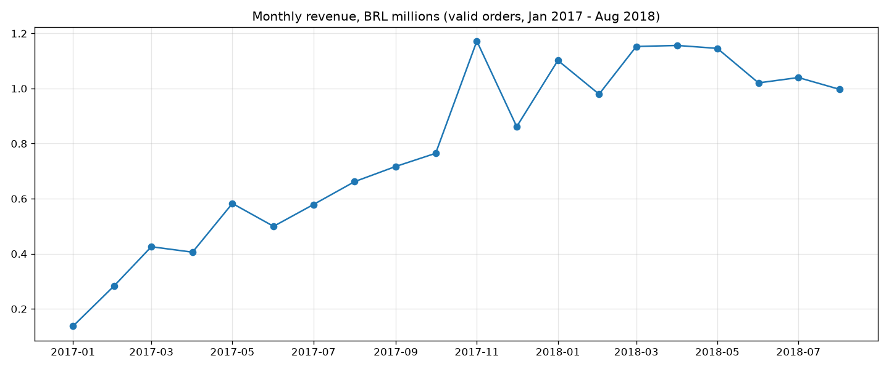
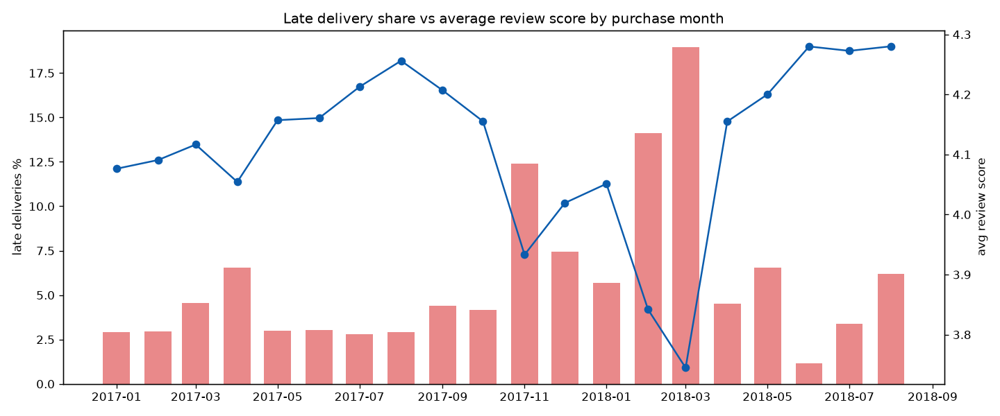

# Olist e-commerce BI

Sales, customer and delivery analysis of the Olist Brazilian marketplace (about 99k orders, Sep 2016 - Oct 2018). The pipeline is pandas for cleaning, DuckDB SQL for a small star schema warehouse, an Excel summary workbook, and a six page Power BI report saved as a PBIP project (TMDL model + PBIR report json) so the whole thing diffs nicely in git.

Data: [Brazilian E-Commerce Public Dataset by Olist](https://www.kaggle.com/datasets/olistbr/brazilian-ecommerce), CC BY-NC-SA 4.0. The raw csvs are not committed, `scripts/download_data.py` pulls them from a public mirror of the Kaggle release.

## What I found

All numbers come out of `sql/queries/*.sql` (results saved in `data/results/`). "Valid" orders exclude canceled and unavailable ones; revenue = item price + freight, in BRL.

- **15.74M BRL** across **98,207** valid orders from **94,990** customers, AOV **160.23 BRL**. Freight is **14.2%** of what buyers pay.
- **Growth**: Jan-Aug 2018 vs Jan-Aug 2017 revenue went from 3.57M to 8.59M (**+140%**), orders 22,562 to 53,531 (+137%). Growth flattens after Jan 2018 at roughly 1.0-1.15M a month.
- **Black Friday**: 24 Nov 2017 is the biggest day in the data, 1,166 orders (178k BRL). November 2017 revenue was up **53.3%** on October.
- **Almost nobody comes back**: only **3.04%** of customers placed a second order. Across the monthly cohorts, on average just **0.46%** of a cohort buys again in month 1 and about 0.25% in months 3 and 6. Growth here is all acquisition.
- **Late delivery kills reviews**: 6,534 delivered orders arrived after the promised date. Those average **2.26 stars** vs **4.28** for on-time orders, and 62.9% of them get a 1-2 star review (vs 9.5%). Overall late rate is 6.8%.
- The worst months were Feb-Mar 2018 (14.1% and **19.0%** late) and the average review dropped to 3.75 in March, then recovered to ~4.28 by June once lateness fell to 1.2%.
- **Geography**: Sao Paulo state alone is **37.4%** of revenue and gets orders in 8.7 days on average. The Southeast (SP, RJ, MG, ES) is 64.6%. Northern states wait far longer (Roraima 29.3 days, Amapa 27.2) and pay more freight (33.5% of order value in Roraima vs 18.2% in SP).
- **Sellers are concentrated**: the top 10% of sellers (305 of 3,053) take **67.4%** of item revenue.
- **Categories**: health & beauty (9.3% of item revenue), watches & gifts (8.9%), bed/bath/table (7.7%), sports & leisure (7.3%), computer accessories (6.7%). Bed/bath/table has the most orders (9,399).
- **Payments**: 75.5% of orders are paid by credit card with 3.55 installments on average; boleto (bank slip) is 19.9%.
- **RFM**: "new big spenders" (14,651 customers) and "lost big spenders" (13,996) each bring ~28% of revenue. True repeat "champions" are only 1,240 customers / 2.5% of revenue.

## Power BI report

`dashboard/OlistCommerce.pbip`, six pages at 1920x1080:

| page | what's on it |
| --- | --- |
| Overview | KPI cards (revenue, orders, customers, AOV, review, late %), revenue vs PY by month, revenue by region, orders by weekday, payment mix, year table |
| Trends | YTD / YoY / MoM cards, revenue vs PY with 3 month rolling, MoM % columns, running total, monthly matrix |
| Customers | new vs returning, repeat %, RFM segment bar + table, cohort retention matrix (cohort month x month n) |
| Products & Geo | category ranking and scorecard, revenue by state, delivery days vs freight share scatter by state |
| Delivery & Reviews | late % and review trend, review score distribution, delivery days by state, state scorecard |
| Category Detail | drill-through on category: trend, seller states, top sellers, weight bands |

Slicers on the main pages: year, month, region, customer state, plus payment type / customer type / category / weight band where it makes sense.

36 DAX measures, full list in [dashboard/DAX_MEASURES.md](dashboard/DAX_MEASURES.md). The interesting ones:

- time intelligence: `Revenue PY`, `Revenue YoY %`, `Revenue PM`, `Revenue MoM %`, `Revenue YTD`, `Revenue Running Total`, `Revenue 3M Rolling`, `Orders YoY %`
- customers: `New Customers` / `Returning Customers` (based on first valid order date), `Repeat Customer %`, `Cohort Retention %`, `RFM Revenue Share`, `Avg Recency Days`
- delivery: `Late Delivery %`, `Avg Delivery Days`, `Low Review %`
- products: `Category Share`, `Category Rank` (RANKX), `Revenue per Seller`, `Cross-state Line %`

Model: `fact_orders` (order grain) and `fact_order_items` (line grain) share `dim_date` (marked date table), `dim_customer`; items also hit `dim_product` and `dim_seller`; orders hit `dim_state` for region. `mart_cohort_retention` is a standalone table from the SQL mart used for the cohort matrix.

### Screenshots / video

**Power BI screenshots are pending.** Power BI Desktop only runs on Windows and I built this on a machine without it, so I have not opened the report in Desktop yet and there are no real dashboard images. There is no walkthrough video for the same reason. I'd rather leave this empty than post mockups.

What is there: `screenshots/charts/` holds plain matplotlib charts made from the same marts by `scripts/make_charts.py` (monthly revenue, late % vs reviews, top categories, state delivery vs freight, cohort heatmap). They are not the Power BI pages.




## How to run

```bash
pip install -r requirements.txt
python scripts/download_data.py     # raw csvs -> data/raw
python scripts/clean_data.py        # pandas cleaning -> data/clean (+ cleaning_log.csv)
python scripts/build_warehouse.py   # sql staging -> marts -> checks, exports data/powerbi/*.parquet
python scripts/run_queries.py       # sql/queries -> data/results/*.csv
python scripts/build_excel.py       # excel/olist_summary.xlsx
python scripts/make_charts.py       # screenshots/charts/*.png
python scripts/make_pbip.py         # rewrites dashboard/ (only needed if you change the model)
python scripts/validate_pbip.py --schemas
```

Then in Power BI Desktop (PBIP and TMDL preview features on): open `dashboard/OlistCommerce.pbip`, go to Transform data > parameters, point `DataFolder` at your local `data\powerbi` folder, and refresh. The parquet files are committed so you can skip the python steps if you only want the report.

## Layout

```
scripts/            python steps above
sql/staging/        views over the cleaned parquet
sql/marts/          dim_date, dim_customer, dim_product, dim_seller, dim_state,
                    fact_orders, fact_order_items, mart_customer_rfm, mart_cohort_retention, mart_monthly
sql/checks/         data quality checks (build fails on any non-warn check)
sql/queries/        analysis queries behind the findings
data/clean/         cleaning_log.csv (parquet ignored)
data/powerbi/       star schema exports read by the report
data/results/       query results + data_quality.csv
excel/              olist_summary.xlsx: KPIs, monthly with MoM/running total formulas, categories,
                    states, RFM, payments, late vs review, cohort heatmap, quality checks
dashboard/          PBIP: OlistCommerce.SemanticModel (tmdl) + OlistCommerce.Report (pbir json)
screenshots/charts/ matplotlib charts (not power bi)
```

## Data quality

12 checks run on every build (`data/results/data_quality.csv`): key uniqueness, orphan keys against every dimension, negative values, review score range, delivery before purchase, unknown states. 11 pass. One is a warning on purpose: 5 single-installment orders where payment differs from items + freight by more than 5 BRL, a known quirk of the source (vouchers / adjustments) that I left as is.

Cleaning notes: some orders have more than one review (559 extra rows), I keep the latest answered one. Two categories are missing from the official translation file and are mapped by hand. 9 zero-value payments dropped. Review text is dropped (not used, Portuguese free text).

## Validation

`scripts/validate_pbip.py` checks the PBIP without needing Power BI: all json parses, pages.json matches the page folders, visuals stay on the 1920x1080 canvas and don't overlap, every column/measure a visual or the drill-through filter uses exists in the TMDL, relationship columns exist, lineage tags are unique, `[measure]` refs inside DAX resolve, TMDL uses tab indentation. With `--schemas` it also validates all 100 json files against Microsoft's published PBIR/PBIP schemas. Current result: 9 tables, 36 measures, 6 pages, 86 visuals, no errors.

That is structural only. DAX is not executed here, so `data/results/14_expected_measures.csv` lists the same numbers computed in SQL to compare against after the first refresh.

## Limitations

- Report not yet opened in Power BI Desktop: no real screenshots, no video, DAX not run against the engine. Visual formatting (colors, label sizes) will probably need a pass once it is.
- Data stops in Aug 2018 for practical purposes; Sep/Oct 2018 have 20 orders total and Sep-Dec 2016 is sparse. Trend charts and the like-for-like YoY use Jan 2017 - Aug 2018.
- Olist anonymises customers; `customer_unique_id` is the closest thing to a person, so repeat rate may be slightly understated.
- Revenue here is buyer-side gross (price + freight), not Olist's take rate or seller margin, which the dataset doesn't include.
- RFM uses quintiles for recency and monetary but a fixed frequency bucket because ~97% of customers have one order.
- Dataset licence is non-commercial (CC BY-NC-SA 4.0).
